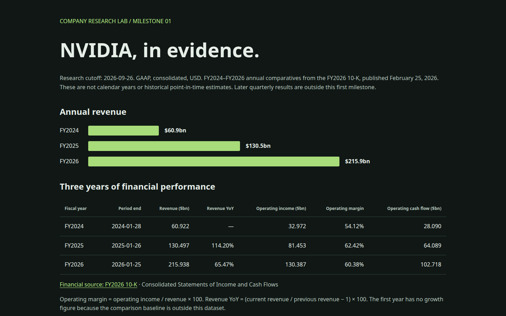

# Financial Ontology Lab — NVIDIA case study

**A financial knowledge graph pipeline: SEC data → exact-period observations → an RDF graph with provenance → a context packet for LLM agents.**



**Highlights**
- An RDF ontology (Company, Filing, FiscalPeriod, Metric, reported/derived observations, management explanations), queried with SPARQL.
- Every derived metric links back to its input observations and source filing (accession, period and SHA-256-pinned snapshot).
- Look-ahead-safe research cutoffs. The arithmetic is deterministic Decimal, and no LLM performs calculations.
- Produces `context.json`, a grounded context packet for agent / GraphRAG workflows, plus HTML and Markdown reports.

**Built with** an AI coding agent in a staged, lesson-by-lesson workflow (see [`docs/project-roadmap.md`](docs/project-roadmap.md)). Stack: Python, RDFLib, SPARQL and the SEC Company Facts API.

---

A practical learning project for financial ontologies, knowledge graphs, context building and agents. Milestone 01 is implemented: an offline, sourced comparison of NVIDIA FY2024–FY2026 revenue, operating margin and operating cash flow, plus management commentary, an RDF graph and a context packet.

**Start here:** open [`reports/nvidia.html`](reports/nvidia.html), then work through [lesson 01](docs/lesson-01.md). A [Markdown report](reports/nvidia.md) is also available.

For the company-independent scope, implementation stages and completion criteria, see the [project roadmap](docs/project-roadmap.md). NVIDIA is the first case study.

## Run

Python 3.11+ is required. From this directory:

```bash
python -m venv .venv
.venv/bin/pip install -r requirements.txt
.venv/bin/pip install --no-deps -e .
.venv/bin/nvidia-research build
.venv/bin/nvidia-research query docs/revenue.sparql
.venv/bin/python -m unittest discover -s tests -v
```

Builds use the included snapshot and require no network access or model API key. Open the HTML report directly in your browser. The build also writes `reports/context.json`, `data/curated/observations.json` and `data/curated/knowledge.ttl`.

## Data and reproducibility

- Raw source: [SEC Company Facts API](https://data.sec.gov/api/xbrl/companyfacts/CIK0001045810.json), NVIDIA CIK 1045810.
- Financial selection: accession `0001045810-26-000021`, the FY2026 10-K, published 2026-02-25. All three years use annual comparative figures from this filing.
- Exact reporting start/end dates, GAAP concept, USD unit and accession identify each fact. The SEC `fy` field is not used as the observation year.
- `data/raw/manifest.json` records the retrieval timestamp and SHA-256. Builds verify the snapshot hash before extracting facts.
- Default research cutoff: 2026-09-26. This is deliberately an annual comparison, excluding FY2027 quarterly updates. An earlier cutoff than the pinned filing date fails instead of leaking later information. This is not a historical backtesting engine.
- Management commentary in `data/curated/commentary.json` was manually reviewed against the FY2025 and FY2026 filings, using their Item 7 sections. It is attributed paraphrase, not automatic extraction or proof of causality.
- Direct SEC filing HTML downloads returned HTTP 403 in this environment. The numerical API snapshot is cached; full filing texts are not. Commentary sources were inspected through browser retrieval and remain linked for review.

To refresh the raw snapshot explicitly, use your own identifying contact string as recommended by the [SEC developer guidance](https://www.sec.gov/about/developer-resources):

```bash
.venv/bin/nvidia-research fetch --user-agent 'NvidiaLearningProject your-email@example.com'
.venv/bin/nvidia-research build
```

Refreshing replaces the cached snapshot and its manifest. The selected accession stays pinned. Source data and narrative are not silently updated by ordinary builds.

## How it fits together

```text
SEC JSON snapshot -> exact-period selection -> reported observations
                                            -> Python calculations
Reviewed management commentary ------------> RDF graph + context packet
                                            -> HTML / Markdown report
```

RDFLib handles the graph and SPARQL queries. Financial arithmetic uses Decimal. Data amounts stay in USD; display converts them to billions. No LLM performs calculations.

The initial ontology defines Company, Security, Filing, FiscalPeriod, Metric, reported and derived observations, and management explanations. Calculated margins link to input observations. This is a small teaching model, not a complete financial ontology; it does not yet include SHACL validation or an OWL reasoner.

## Scope and next milestone

Implemented: financial ingestion, period selection, provenance, deterministic calculations, graph querying, static context assembly and reports.

Next: expand the graph with NVIDIA business segments and market categories, add validation and explicit reasoning, then document retrieval and a tool-using agent. Technical indicators and prices come later. The current project contains no autonomous agent, price predictions or trading execution.
