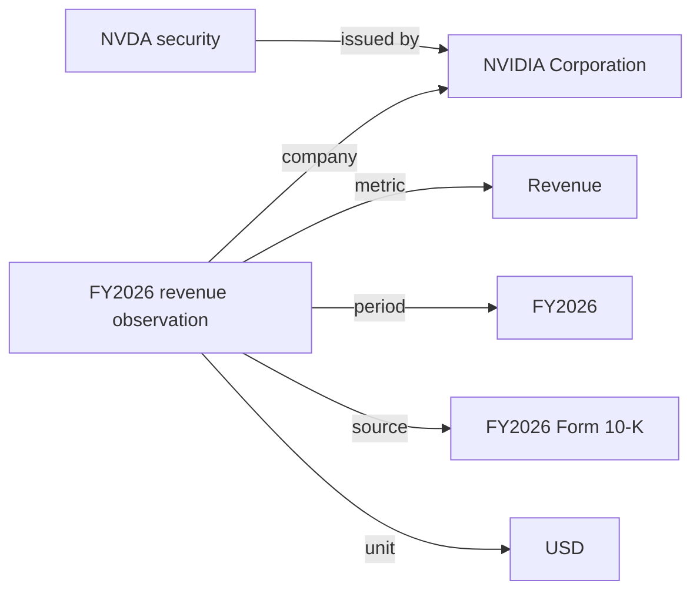

# Lesson 01: What does a financial fact mean?

Our question: How did NVIDIA's revenue, operating margin and operating cash flow change across FY2024–FY2026, and what explanations did management provide?

Start by opening `reports/nvidia.html` in a browser. The financial tables are computed from the cached SEC API response. Management explanations are separately labeled, manually reviewed paraphrases with filing locations.

## 1. A number needs context

Find `fy2026-revenue` in `data/curated/observations.json`. Read its metric, unit, period start and end, filing date and source. The amount is in dollars; the report converts it to billions for display.

The period tells us when the business activity happened. The filing date tells us when this version of the information became public. These are different kinds of time.

Our three annual periods come from one FY2026 filing's comparative statements. This makes the comparison reproducible, but does not recreate the information available to an investor in 2024. A future historical-analysis mode must select filings actually available at each historical cutoff.

## 2. Ontology versus knowledge graph

The ontology describes types and relationships: a reported observation concerns a company, metric and period; it has a value, unit and source. The knowledge graph contains instances of those types, such as NVIDIA and its FY2026 revenue observation.



The company is distinct from its traded security. The graph stores annual observations; daily prices can live in a table when we add them.

Open `data/curated/knowledge.ttl`. Turtle is a readable RDF serialization. A statement has a subject, predicate and object. Prefixes shorten identifiers; `a` means “is an instance of.” The `example.org` namespace is our local teaching vocabulary, not an official financial standard.

## 3. Ask a graph question

From the project directory:

```bash
.venv/bin/nvidia-research query docs/revenue.sparql
```

This asks for observations matching NVIDIA and the revenue metric, including their evidence. Change `fin:revenue` to `fin:operating_cash_flow` and run it again. Predict the result before running it.

## 4. Separate facts, calculations and explanations

- **Reported:** operating income and revenue from the filing.
- **Calculated:** operating margin = operating income / revenue × 100.
- **Attributed explanation:** management's account of the drivers.

Find `fy2026-operating_margin` in the graph. Its provenance points to both input observations. This is arithmetic with evidence lineage, not yet a general semantic reasoner. The graph declares subclass relationships but does not automatically materialize inferred types.

Exercise: why does revenue increasing not imply that operating margin also increases? Check the FY2025–FY2026 figures. Margin changes are expressed in percentage points, which differ from percentage growth.

## 5. Inspect a context packet

Open `reports/context.json`. It collects the question, cutoff, relevant observations, calculations, management explanations and limitations. This is a fixed context-building workflow for one question. Later, a retriever will select evidence dynamically, and an agent will decide which tools to use.

Exercise: which fields would you remove for a question only about operating cash flow? Which source information must remain?

## 6. Next sessions

1. Extend the ontology with business segments and market categories. Verify their meanings before equating them.
2. Add SHACL constraints for required units, periods and sources; deliberately insert an invalid fact.
3. Add explicit reasoning rules and an explanation trace; distinguish logical entailment from business hypotheses.
4. Retrieve filing passages automatically and evaluate citation support against reviewed examples.
5. Add an LLM tool loop with bounded steps and an inspectable context packet.
6. Add price data and technical indicators, then peer comparisons and exposure analysis.

For each session: understand one concept, implement one behavior, inspect the result, and try a failure case.
