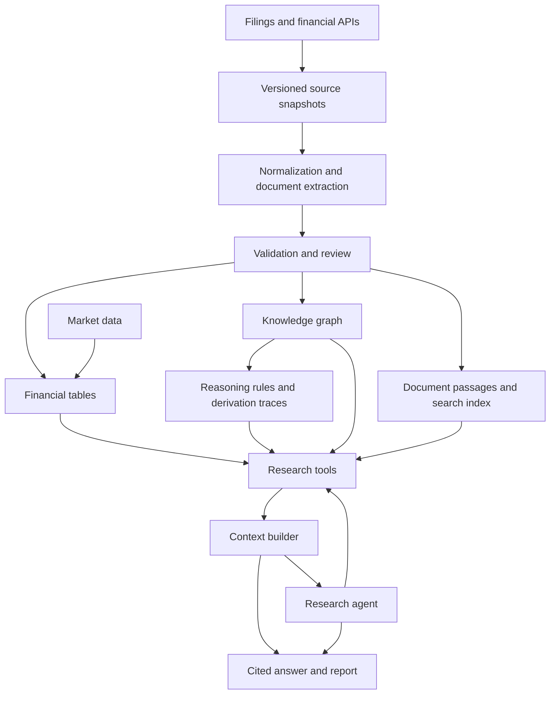

# Company Research and Reasoning Lab — Project Roadmap

This project builds a company research assistant while teaching ontology design, knowledge graphs, semantic reasoning, context engineering and tool-using agents through working software. NVIDIA is the first case study; the architecture will support other companies.

The central problem is that useful company information is scattered across financial statements, narrative reports and market data. Answering a question requires selecting comparable information, connecting it to evidence, calculating accurately and explaining uncertainty.

Our intended result is a system where a user selects a company, a question and a research cutoff date, and receives an analysis with supporting sources, reproducible calculations and a visible investigation trace.

Example questions include:

- How have revenue, profitability and operating cash flow changed?
- Which business segments contributed to those changes?
- What explanations does management provide, and what evidence supports them?
- Which disclosed risks or relationships deserve further investigation?
- What changed between two reports?
- How did price and volume behave around a disclosed event?

## The concepts we will implement

| Concept | Role in the project |
| --- | --- |
| Ontology | Define entities, relationships and their meaning: Company, Security, Filing, Period, Metric, Observation, Segment and Risk. |
| Knowledge graph | Store concrete instances and connections, with dates and sources. |
| Semantic reasoning | Derive conclusions from declared meanings and explicit rules, retaining the premises used. |
| Data validation | Check whether observations and relationships satisfy required constraints. |
| Retrieval | Find relevant financial observations and document passages. |
| Context engineering | Assemble the evidence, instructions and task state needed for a particular model call. |
| Agent | Choose tools and investigation steps in response to the question and intermediate results. |
| Evaluation | Check whether calculations, evidence selection, reasoning and answers are reliable. |

We will distinguish reported facts, calculated values, management statements, rule-derived conclusions and model interpretations throughout the system. These categories have different evidential strength.

## Stages at a glance

| Stage | Deliverable | Status |
| --- | --- | --- |
| 1. Evidence and calculations | Reproducible financial comparison with source references | Initial case study implemented |
| 2. Reusable ontology and graph | Company-independent model, configurable ingestion and graph queries | Small prototype exists; generalization planned |
| 3. Validation and semantic reasoning | Constraints, inference rules and explanation traces | Planned |
| 4. Document knowledge | Searchable filing passages and reviewed extracted claims | Planned |
| 5. Context building and grounded answers | Question-specific evidence packets and cited answers | Fixed packet exists; dynamic retrieval planned |
| 6. Tool-using research agent | Bounded investigations with visible tool calls and results | Planned |
| 7. Market data and technical analysis | Reproducible price indicators linked to research events | Planned extension |
| 8. Multiple companies and monitoring | Comparable company research, relationship analysis and change reports | Planned extension |

Stages 1–6 form the core learning project. Stages 7–8 expand its financial usefulness. We will add a demonstration and learning exercise at each stage rather than wait for the whole platform to be complete.

## Stage 1 — Establish reliable evidence and calculations

**Purpose:** Learn what makes a financial number meaningful and reproducible.

Implement source ingestion, cached snapshots, retrieval metadata, explicit reporting periods and deterministic calculations. Each observation records the company, metric, value, unit, period and source. Keep publication time separate from the period the observation describes.

The first output is an annual comparison of revenue, operating income, operating margin and operating cash flow, with a simple report and attributed management commentary.

**Completion criteria:** Rebuilding from the same snapshot reproduces the figures; selected amounts match the source statements; incorrect units or periods cannot silently enter a calculation. Tests cover missing data, conflicting values and unavailable information at the chosen cutoff.

**Current position:** The initial case study is implemented. It uses one pinned annual filing's comparative figures. It does not yet reconstruct what was known at arbitrary historical dates. Narrative commentary is manually curated.

**Learning exercise:** Trace one displayed figure back to its raw observation and identify every field needed to interpret it correctly.

## Stage 2 — Build a reusable ontology and knowledge graph

**Purpose:** Learn how to model financial meaning and connect evidence across entities.

Separate the ontology from company-specific data. Define stable identifiers, entity types and relationships. Introduce business segments, market categories, disclosures and claims. Document distinctions such as company versus security, segment versus market category, and reporting period versus publication date.

Make company selection, fiscal periods, source filings and metric mappings configurable. Store observations and their evidence in an RDF graph; use SPARQL to answer structured questions. Review existing financial vocabularies for selected mappings as the model develops.

**Deliverables:** A versioned ontology, a data dictionary, configurable ingestion and example graph queries.

**Completion criteria:** A second small company fixture loads through configuration without changes to the core model. Queries identify each company's observations and sources independently. Definitions explain ambiguous concepts and unsupported mappings explicitly.

**Learning exercise:** Follow the path from a company to a segment, a financial observation and its filing. Explain which parts describe the model and which are actual data.

## Stage 3 — Add validation and semantic reasoning

**Purpose:** Learn the difference between checking data and deriving knowledge.

Use SHACL constraints to validate required fields, datatypes and relationships. Add a small, deliberately bounded set of RDFS/OWL inferences and explicit application rules. Keep asserted facts separate from inferred results and attach the premises and rule identifier to each derived conclusion.

For example, a class hierarchy can establish that every reported financial observation is an observation. A separately defined business rule can flag a combination of financial changes for review. A review flag is an investigation prompt, not proof of a financial problem.

**Deliverables:** Validation shapes, a rule catalogue, valid and invalid examples, and readable explanation traces.

**Completion criteria:** Deliberately invalid observations are rejected or flagged. Every inferred result has an inspectable derivation. Missing information remains unknown unless a specific application rule defines how absence should be handled.

**Learning exercise:** Insert a missing unit, then a valid fact that triggers a rule. Compare the validation report with the inference explanation.

## Stage 4 — Turn documents into searchable evidence

**Purpose:** Connect structured financial observations to narrative disclosures.

Acquire and preserve filing text with section or page locations. Split it into useful passages and support text search. Add semantic retrieval where evaluation shows it helps. Extract candidate entities, relationships and claims with supporting passages, then validate and review them before promoting them into accepted graph data.

Maintain stable identities, source versions and publication dates. Preserve conflicting claims and distinguish a superseded disclosure from a current one. Treat management explanations as attributed statements.

**Deliverables:** A small filing corpus, passage search, candidate extraction records and a review workflow.

**Completion criteria:** A retrieved claim can be checked against a preserved source passage. Rejected extraction candidates do not become accepted facts. Examples cover ambiguity, contradictions and missing evidence.

**Dependency:** Reliable filing access or user-supplied documents. The current numerical API snapshot works, but full filing text is not yet cached.

**Learning exercise:** Compare a model's proposed relationship with its supporting passage and decide whether the passage actually establishes that relationship.

## Stage 5 — Build context and produce grounded answers

**Purpose:** Learn how evidence is selected and assembled for an LLM.

Turn a research question into retrieval requests over structured observations, graph relationships and document passages. Filter by company, period and publication cutoff. Rank and deduplicate evidence, preserve conflicting evidence, and assemble an inspectable context packet within a defined size budget.

Use a model to explain the selected evidence. Financial calculations remain in deterministic tools. Answers distinguish established observations, attributed explanations and unresolved questions, with citations tied to the claims they support.

**Deliverables:** Dynamic context construction, a simple question interface and a reviewed evaluation set of approximately 15–25 questions.

**Completion criteria:** Benchmark calculations are correct, citations support their associated claims, and unsupported questions receive explicit uncertainty. Compare document-only retrieval with graph-assisted retrieval on the same questions and record where each approach helps or fails.

**Dependency:** Select a hosted or local model based on capability, cost and the environment available when implementation begins.

**Learning exercise:** Remove a source or change the cutoff date and inspect how both the context packet and answer change.

## Stage 6 — Add a tool-using research agent

**Purpose:** Move from a fixed answering workflow to an adaptive investigation.

Expose focused tools such as company resolution, metric retrieval, financial calculations, document search and relationship queries. Let one agent choose the next tool based on the question and previous results. Set explicit step and cost budgets, stopping conditions and recovery behavior for missing data or tool failures.

Persist task state and evidence references so a research session can resume without treating prior model prose as verified facts. Record tool calls, inputs, outputs and concise action summaries for inspection.

**Deliverables:** A research agent, tool contracts, execution traces and an evaluation suite covering multi-step questions and failures.

**Completion criteria:** The agent completes representative investigations within its budget, respects the research cutoff, and reports unresolved gaps. The user can inspect which evidence and calculations produced each answer. Compare its accuracy, latency and cost with the fixed workflow from Stage 5.

**Learning exercise:** Ask a question requiring both a calculation and a document lookup, then inspect why each tool was needed.

Multiple agents are a possible later experiment only if evaluation identifies a benefit; they are not a requirement for this stage.

## Stage 7 — Add market data and technical analysis

**Purpose:** Extend company research with reproducible analysis of traded securities.

Select a price-data provider and record its coverage, adjustment conventions and usage terms. Store price and volume series in tables, linking relevant securities and events to the graph. Add moving averages, returns, volatility and RSI with explicit formulas, window lengths and handling of missing observations.

Connect financial publications to price charts using actual publication timing and trading calendars. Treat price behavior around an event as an observation; proximity alone does not establish causation.

**Deliverables:** Price charts, indicator calculations and event comparison views.

**Completion criteria:** Indicators agree with independently checked examples; split adjustments, trading dates and insufficient history are handled consistently. Any later backtesting uses only information available at the simulated time and a separately defined evaluation method.

**Dependency:** Provider selection and confirmation of historical data access. Paid data is not assumed.

**Learning exercise:** Compare raw and adjusted price series around a corporate action and explain how the difference affects an indicator.

## Stage 8 — Expand to multiple companies and monitoring

**Purpose:** Make the platform useful for repeated research and relationship analysis.

Add companies through configuration, with explicit checks for comparability of fiscal periods and accounting concepts. Extend the graph with disclosed company relationships and their evidence. Represent uncertain or incomplete exposures rather than inventing a complete network.

Track new filings and produce change reports showing updated observations, revised disclosures and affected prior conclusions. Add a dashboard for comparisons, evidence inspection and research history.

**Deliverables:** Multi-company comparisons, relationship queries, versioned research results and on-demand change reports. Scheduled monitoring can follow once update behavior is reliable.

**Completion criteria:** Comparisons explain material differences in definition or period. A changed disclosure can be traced to the source version and dependent conclusions that need review. Repeated ingestion does not duplicate entities or facts.

**Learning exercise:** Update a source observation and identify which report sections or inferences must be recomputed.

## Intended architecture

Python remains the initial implementation language. RDFLib and SPARQL support the graph. JSON snapshots and local files keep the first stages inspectable. We will introduce additional storage, search services or orchestration frameworks when a stage demonstrates a need for them.

## How we will learn and measure progress

Each stage follows the same cycle: explain the concept, inspect a small example, implement the behavior, test a meaningful failure case, and document what changed. The result should include a runnable demonstration and a short lesson the user can modify independently.

Evaluation grows alongside functionality. We will track exact numerical agreement, source support, period and unit correctness, inference validity, retrieval relevance, handling of unknowns, and eventually agent cost and latency. A stage is complete when its stated criteria are demonstrated, not when it has accumulated a particular number of tools.

## Immediate next step

Review the existing comparison and Lesson 01, then begin Stage 2: extract the small prototype vocabulary into an explicit ontology, document its definitions, and remove company-specific assumptions from the ingestion path. Validate that design with a second small fixture before expanding the amount of data.

The overall goal is a research platform whose evidence, reasoning and actions can be inspected—and a practical understanding of how to build each part.
